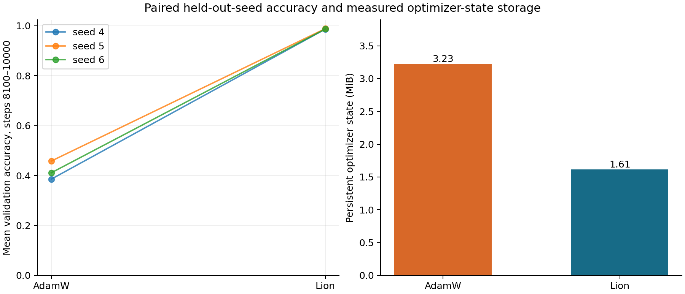

# Lion on Modular Multiplication — COMP6704 Group 7

The `Lion` branch contains HUANG Yuqi's Lion contribution to the group's **Deep Learning Optimizer Comparison** project. It includes a local Lion implementation, paired AdamW comparisons, complete metric logs, sensitivity and stability studies, and report/presentation material.

The required member contribution is an independently implemented algorithm. The parameter update in [`lion_experiment/optim.py`](lion_experiment/optim.py) is implemented locally; it does not invoke a Lion library or the official reference. PyTorch supplies tensor operations and the optimizer interface. AdamW is the built-in comparison. The Google reference in `vendor/` is used only in correctness tests.

## Main result and scope

On mod-97 multiplication with the group's two-layer Transformer, Lion reached 95% validation accuracy in **3/3** fresh-seed runs; AdamW reached it in **0/3** within 10,000 updates. Both received three learning-rate trials on a separate tuning seed, with matched per-step weight shrinkage. This confirms a benefit **within a low-shrinkage regime identified by earlier exploration**.

| Measurement | Lion | AdamW |
|---|---:|---:|
| Validation ≥95%, three consecutive evaluations | 3/3 | 0/3 |
| First qualifying start, successful runs only | 4666.7 ± 378.6 steps | >10,000 in all runs |
| Validation ≥99%, three consecutive evaluations | 2/3 | 0/3 |
| Mean validation accuracy, steps 8100–10,000 | 98.76% | 41.84% |
| Final validation accuracy | 98.86% | 41.64% |
| Persistent optimizer state | 1.61 MiB | 3.23 MiB |
| Total peak allocated GPU memory | 130.61 MiB | 132.22 MiB |

Means and sample SD are descriptive over three seeds. Failed crossings are censored, not counted as successful at the budget. This is neither a universal ranking nor a significance claim. Both selected learning rates are at candidate-grid boundaries; longer budgets and wider searches could change the ranking. Validation data are used for tuning; these are validation results, not an independent test-set estimate.



Earlier high-decay studies favored AdamW on first crossing and Lion on observed post-crossing stability. Those results remain in the repository; see [study history](docs/STUDY_HISTORY.md). See [all current results](results/advantage_validation/analysis/RESULTS.md) and [locked protocol](docs/ADVANTAGE_VALIDATION_PROTOCOL.md).

## Install and check

Use Python 3.10. Run commands from this repository's root. Linux, PyTorch 2.5.1+cu124 and one A100 GPU were used for the reported measurements. CPU execution supports tests and smoke checks; timings and exact training trajectories can differ on other software/hardware.

```bash
git clone --branch Lion --single-branch git@github.com:COMP6704-G7/grokcomp.git
cd grokcomp
python3.10 -m venv .venv
source .venv/bin/activate
python -m pip install torch==2.5.1 --index-url https://download.pytorch.org/whl/cu124
python -m pip install -r requirements.txt
python -m pytest -q
```

For a CPU-only environment, replace `cu124` with `cpu` in the PyTorch install command. No external dataset download or access to the private reference repository is required.

```bash
# Check the training path without a full GPU study.
python -m lion_experiment.train --optimizer lion --device cpu \
  --max-steps 5 --eval-every 5 --output runs/smoke_lion

# Validate stored evidence, source hashes, split/initialization pairing and metrics.
python scripts/verify_release.py

# Regenerate tables and figures from the included logs; no training required.
python scripts/analyze_advantage.py
```

## Reproduce the main training study

Always use a **new output directory** when rerunning. The archive in `results/` contains completed summaries; the runner resumes/skips completed runs there rather than retraining them.

```bash
CUDA_VISIBLE_DEVICES=0 python scripts/confirm_advantage.py \
  --config configs/advantage_validation.json \
  --output runs/advantage_reproduction --stage all
python scripts/analyze_advantage.py --root runs/advantage_reproduction
```

This performs 12 sequential runs: six tuning runs on seed 7 and six confirmation runs on seeds 4–6, each exactly 10,000 updates. The runner writes the design lock before tuning, freezes selection before confirmation, and checks paired model initialization and data splits. It uses no early stopping. See [reproduction details and historical studies](docs/REPRODUCIBILITY.md).

Raw evidence is included as `metrics.jsonl`, `config.json`, `metadata.json`, and `summary.json` for each run, plus the design, selection evidence, source snapshots, CSV/JSON summaries and PNG/PDF figures. Full training checkpoints and environments are excluded; fresh training regenerates checkpoints. The small legacy `.pt` file contains metric histories, not model weights.

## Files and group handoff

| Path | Contents |
|---|---|
| `lion_experiment/optim.py` | Local Lion parameter/momentum updates |
| `lion_experiment/model.py`, `train.py`, `metrics.py` | Shared model/data, paired training, threshold metrics |
| `configs/advantage_validation.json` | Current fixed-horizon design and candidate grids |
| `scripts/confirm_advantage.py`, `analyze_advantage.py` | Current experiment and analysis entry points |
| `tests/`, `vendor/` | Independent arithmetic, official equivalence, protocol/resume tests |
| `results/advantage_validation/` | All current tuning and confirmation evidence |
| `results/lion_study/`, `matched_budget_study/`, `diagnostics/` | Historical comparisons and diagnostics |
| [`docs/REQUIREMENTS_AUDIT.md`](docs/REQUIREMENTS_AUDIT.md) | Official group requirements mapped to this member's work |
| [`docs/LION_CONTRIBUTION.md`](docs/LION_CONTRIBUTION.md) | Consolidated problem, algorithm, analysis and group report handoff |
| [`deliverables/Lion_Contribution.pdf`](deliverables/Lion_Contribution.pdf) | Printable member contribution with repository link |
| [`deliverables/Lion_优势验证展示.pptx`](deliverables/Lion_优势验证展示.pptx) | Six-slide result presentation |
| [`deliverables/Lion_优势验证讲稿.md`](deliverables/Lion_优势验证讲稿.md) | Speaker notes |

The legacy `Lion_Report.*` and `Lion_Presentation.*` describe earlier studies; use the consolidated contribution and current result slides for handoff. This repository supplies the Lion portion, not the final combined group submission. The group must integrate its other independently implemented optimizers, unify any cross-member comparison, and prepare the final report/slides PDF. Include **https://github.com/COMP6704-G7/grokcomp/tree/Lion** in that report's abstract or a footnote, as required by the rubric.

## Attribution

The group model and task derive from `COMP6704-G7/grokcomp` commit `93b2248e351d4bb9e4dda8ac32a6999b8970404b`, based on [ironjr/grokfast](https://github.com/ironjr/grokfast). An immutable original source is included for model/split equivalence tests. The inherited MIT notice is retained in [`LICENSE`](LICENSE); the official Lion reference retains its Apache-2.0 notice and [`vendor/LICENSE.lion`](vendor/LICENSE.lion). See [`docs/PROVENANCE.md`](docs/PROVENANCE.md). Lion is an existing algorithm, not an algorithm invented in this project.

The original Grokfast README is preserved in [README_GROKFAST.md](README_GROKFAST.md).
