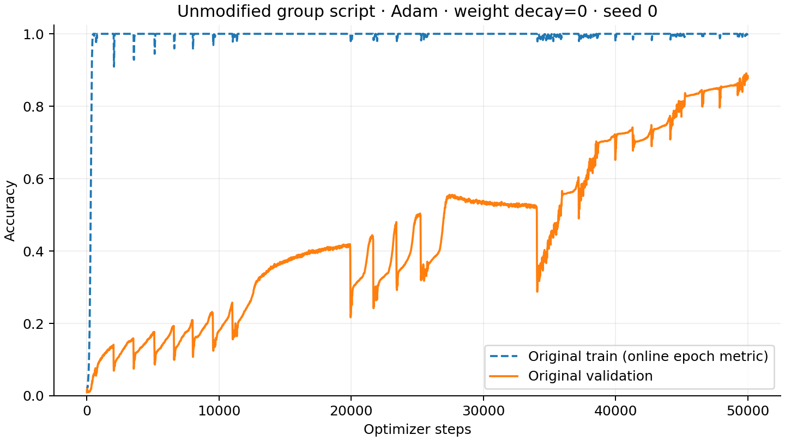
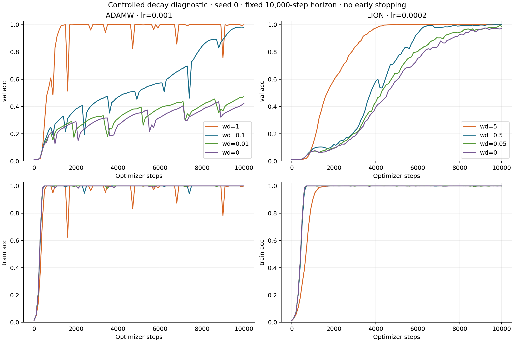
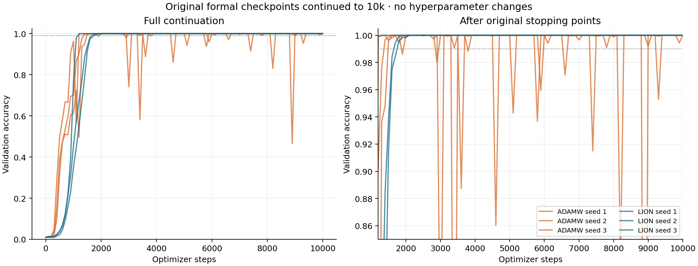

> 当前状态：初版配置比较，第二轮正在/已完成基线诊断；不代表组内最终实验完成。

# Lion on Modular Multiplication

We implemented Lion and evaluated it against a fixed AdamW baseline on mod-97 multiplication, using the group's two-layer Transformer. Three learning-rate trials on seed 0 selected Lion lr=3e-04. The selected configuration was evaluated on three new, paired seeds (1, 2, 3). Both methods reached 99% validation accuracy in all formal runs. Lion reduced the measured memorization-to-generalization gap and optimizer-state memory, but did not improve mean steps or mean wall time to the first three-checkpoint 99% validation crossing. Continuing the original six checkpoints to 10000 steps found that all three Lion runs stayed above 99% after confirmation, whereas all three AdamW runs later fell below 95%. The retrospective within-horizon stable99 starting point averaged 1566.7 steps for Lion and 7100 steps for AdamW. Thus first crossing and observed sustained generalization give different rankings; the latter is a follow-up diagnostic, not a replacement primary endpoint.

## Results

# Lion / AdamW 实验结果

数据来自真实训练日志；仅汇总 formal 阶段，pilot 与单 seed 学习率筛选不混入正式统计。

| 方法 | val95 达标 | val99 达标 | Ttrain99 | Tval95 | Tval99 | ΔT | val99 时间/s | 每步/ms |
|---|---|---|---|---|---|---|---|---|
| LION | 3/3 | 3/3 | 1200.0 ± 100.0 | 1433.3 ± 288.7 | 1566.7 ± 321.5 | 366.7 ± 230.9 | 10.5 ± 2.5 | 6.3 ± 0.2 |
| ADAMW | 3/3 | 3/3 | 500.0 ± 0.0 | 1333.3 ± 152.8 | 1366.7 ± 152.8 | 866.7 ± 152.8 | 9.6 ± 1.3 | 6.7 ± 0.3 |

均值 ± 样本标准差（ddof=1）；每列 CSV 同时给出有效 n。达标时间与步数仅对成功运行统计。
连续三次评估达标后记第一检查点；停止发生在第三检查点。ΔT 保留原始符号。

## 逐次运行

| 方法 | seed | lr | ηλ | Tval99 | 最终 val acc | 训练步数 |
|---|---|---|---|---|---|---|
| adamw | 1 | 1e-03 | 0.001 | 1500 | 99.9785% | 1700 |
| adamw | 2 | 1e-03 | 0.001 | 1400 | 100.0000% | 1600 |
| adamw | 3 | 1e-03 | 0.001 | 1200 | 100.0000% | 1400 |
| lion | 1 | 3e-04 | 0.0015 | 1200 | 100.0000% | 1400 |
| lion | 2 | 3e-04 | 0.0015 | 1800 | 99.8497% | 2000 |
| lion | 3 | 3e-04 | 0.0015 | 1700 | 99.9570% | 1900 |

## 资源

| 方法 | 峰值分配显存/MiB | 优化器持久状态/MiB |
|---|---|---|
| lion | 130.61 | 1.61 |
| adamw | 132.22 | 3.23 |

显存为 torch.cuda.max_memory_allocated，包含模型、梯度、状态和前向/反向临时分配；不等于 nvidia-smi 占用。
每步耗时包含取样、前向、反向、优化器和同步；不含完整集合评估。wall time 包含评估和运行期间日志/检查点开销，不含模型初始化。
断点续跑的离线停机时间不计入 wall time，segments>1 的运行需单独解释计时。

## Interpretation

Lion reached train99 at 1200.0 ± 100.0 steps, compared with 500.0 ± 0.0 for AdamW. Its smaller delay therefore partly reflects later memorization. The paired Lion-minus-AdamW differences in val99 steps were −300, +400 and +500 for seeds 1, 2 and 3. Lion won on one of three seeds and required 200 more steps on average. The results do not establish a general convergence advantage for Lion.

## Computation and storage

Mean training-step time was 6.34 ± 0.24 ms for Lion and 6.67 ± 0.28 ms for AdamW. This includes sampling, forward/backward passes, the optimizer, scheduler and synchronization, but excludes full-set evaluation. Peak allocated GPU memory averaged 130.61 MiB and 132.22 MiB respectively. Persistent optimizer state was 1.61 MiB versus 3.23 MiB. Halving moment storage reduced total peak allocation by only about 1.2%, because model, gradients, activations and temporary tensors still dominate.

## Limitations

- Three formal seeds provide limited precision; mean ± sample SD is descriptive, not a significance claim.
- Lion received three single-seed learning-rate trials. AdamW used a fixed reference setting; this is not an equal-search-budget comparison of tuned optima.
- Lion lr=3e−4 and weight decay=5 give ηλ=0.0015; AdamW gives 0.001. Learning rate and effective shrinkage both vary in the sensitivity study.
- The budget and weight decays are local frozen starting values from the plan and still require group confirmation before replacing a shared baseline.
- All initial runs reached the stopping rule early. This high-decay setting does not show a long grokking plateau; the later fixed-horizon follow-up separately checks post-stop stability.
- The group architecture and split RNG are preserved. The new independent batch sampler and checkpoint evaluation differ from the original epoch-logging script; old logs cannot be compared directly.
- Step and wall times are short-run measurements on one A100 with synchronized FP32 execution. They do not isolate optimizer-kernel latency or establish a hardware-independent speedup.

## 等次数调参补充分析

# Lion / AdamW 等次数调参补充实验

数据来自真实训练日志；仅汇总 formal 阶段，pilot 与单 seed 学习率筛选不混入正式统计。

| 方法 | val95 达标 | val99 达标 | Ttrain99 | Tval95 | Tval99 | ΔT | val99 时间/s | 每步/ms |
|---|---|---|---|---|---|---|---|---|
| LION | 3/3 | 3/3 | 1200.0 ± 100.0 | 1433.3 ± 288.7 | 1566.7 ± 321.5 | 366.7 ± 230.9 | 10.5 ± 2.5 | 6.3 ± 0.2 |
| ADAMW | 3/3 | 3/3 | 500.0 ± 173.2 | 866.7 ± 305.5 | 933.3 ± 251.7 | 433.3 ± 321.5 | 6.3 ± 1.7 | 6.4 ± 0.0 |

均值 ± 样本标准差（ddof=1）；每列 CSV 同时给出有效 n。达标时间与步数仅对成功运行统计。
连续三次评估达标后记第一检查点；停止发生在第三检查点。ΔT 保留原始符号。

## 逐次运行

| 方法 | seed | lr | ηλ | Tval99 | 最终 val acc | 训练步数 |
|---|---|---|---|---|---|---|
| adamw | 1 | 2e-03 | 0.002 | 900 | 100.0000% | 1100 |
| adamw | 2 | 2e-03 | 0.002 | 1200 | 100.0000% | 1400 |
| adamw | 3 | 2e-03 | 0.002 | 700 | 100.0000% | 900 |
| lion | 1 | 3e-04 | 0.0015 | 1200 | 100.0000% | 1400 |
| lion | 2 | 3e-04 | 0.0015 | 1800 | 99.8497% | 2000 |
| lion | 3 | 3e-04 | 0.0015 | 1700 | 99.9570% | 1900 |

## 资源

| 方法 | 峰值分配显存/MiB | 优化器持久状态/MiB |
|---|---|---|
| lion | 130.61 | 1.61 |
| adamw | 132.22 | 3.23 |

显存为 torch.cuda.max_memory_allocated，包含模型、梯度、状态和前向/反向临时分配；不等于 nvidia-smi 占用。
每步耗时包含取样、前向、反向、优化器和同步；不含完整集合评估。wall time 包含评估和运行期间日志/检查点开销，不含模型初始化。
断点续跑的离线停机时间不计入 wall time，segments>1 的运行需单独解释计时。

此设计在首次固定基线结果之后加入，是补充探索性分析；两种方法各3次seed0调参、相同步数上限和停止规则，实际消耗计算量可不同。

## 第二轮基线诊断

# 第二轮诊断与重跑

## 已查明的配置差异

原仓库入口实际默认 Adam、weight_decay=0；上一轮本地协议采用 AdamW、weight_decay=1，Lion=5。原文件的注释虽提到AdamW/1，但注释不是入口实际配置。此前把这一试跑值当作正式组内基线并过早宣布完成，是实验解释上的错误。

上一轮日志是真实结果，仍只对其明确配置有效；不能拿它替代原仓库基线复现，也不能由此推断Lion对长延迟grokking的普遍影响。

## 泄漏与评估核对

六个已保存的正式检查点经独立推理复算，准确率与日志一致；训练验证索引不相交且覆盖全集。打乱验证标签后的准确率约0.67%–1.31%；改变未来答案token，对前一个位置的logits影响为0。这些检查没有发现答案泄漏或把训练集冒充验证集的证据。详情见checkpoint_audit.json。

## 原始脚本复现

原始代码不改训练循环，seed0、Adam/λ=0，运行50000步。最终训练准确率99.63%，验证准确率87.84%；首次单次val95=None，val99=None。这里报告原始逐epoch验证指标，不与新协议三次连续阈值混为同一种统计。

## 控制变量重跑

保持原模型、seed0划分、batch、评估及训练取样方式不变；每个方法内部仅改变weight decay。AdamW学习率固定1e-3；Lion固定2e-4、衰减为AdamW的5倍，保证两方法的峰值ηλ匹配。所有运行固定10000步，关闭达标停止，以检查后续稳定性。此为探索性诊断，不能当成新的三seed正式比较。

| 优化器 | λ | ηλ | Ttrain99 | Tval95 | Tval99 | 最终val | 首次确认99%后最低val | 预算内持续99%起点 |
|---|---|---|---|---|---|---|---|---|
| adamw | 0 | 0 | 500 | >10000 | >10000 | 42.40% | — | — |
| adamw | 0.01 | 1e-05 | 500 | >10000 | >10000 | 47.21% | — | — |
| adamw | 0.1 | 0.0001 | 500 | 9400 | >10000 | 98.00% | — | — |
| adamw | 1 | 0.001 | 600 | 1200 | 1300 | 100.00% | 51.31% | 9100 |
| lion | 0 | 0 | 700 | 8500 | >10000 | 97.08% | — | — |
| lion | 0.05 | 1e-05 | 700 | 8200 | >10000 | 98.78% | — | — |
| lion | 0.5 | 0.0001 | 700 | 6100 | 6500 | 99.96% | 97.85% | 8000 |
| lion | 5 | 0.001 | 1300 | 3800 | 4300 | 100.00% | 99.74% | 4300 |

预算内持续99%起点是回顾性指标：从该检查点起到10000步的所有观测均≥99%，且至少有三个观测。它仅表示已观察区间内的稳定性，不保证预算结束之后也保持；不替换原计划中的三次连续阈值。

诊断seed0的高衰减AdamW在首次确认99%之后出现过明显回落；原停止规则会掩盖这种后续不稳定。不能据此断言原三个正式seed都出现同样回落；六个原检查点的续跑另列于formal_stability。这是停止规则与结论范围的限制，不能把首次达标等同于稳定泛化。

## 原六正式检查点稳定性续跑

# 原六次正式运行的固定预算续跑

原有六次固定基线比较的参数、优化器状态、随机数和取样状态完整延续到10000步，不重新调参。原始日志前缀逐行相同，已自动验证。此前的首次阈值指标保留，新增稳定性观察。

| 方法 | seed | 首次val99 | 原停止步 | 达标后最低val | 最低点步数 | 预算内持续99%起点 | 最终val |
|---|---|---|---|---|---|---|---|
| adamw | 1 | 1500 | 1700 | 58.10% | 3400 | 6700 | 100.00% |
| adamw | 2 | 1400 | 1600 | 46.52% | 8900 | 9400 | 100.00% |
| adamw | 3 | 1200 | 1400 | 94.27% | 5100 | 5200 | 100.00% |
| lion | 1 | 1200 | 1400 | 100.00% | 1400 | 1200 | 100.00% |
| lion | 2 | 1800 | 2000 | 99.85% | 2000 | 1800 | 100.00% |
| lion | 3 | 1700 | 1900 | 99.96% | 1900 | 1700 | 100.00% |

预算内持续99%起点是回顾性指标：从该点到10000步所有已观察准确率都≥99%，且至少三个检查点。它不是事先注册的主指标，也不保证10000步以后稳定；不能静默替换原有首次达标排名。

续跑分为两个计算时段，离线停机不计时；这里比较步数和准确率，不据此重新宣称wall-time优势。本项只核对原固定AdamW/1与Lion/5比较，没有继续补充搜索选出的AdamW/2e-3那一组。
