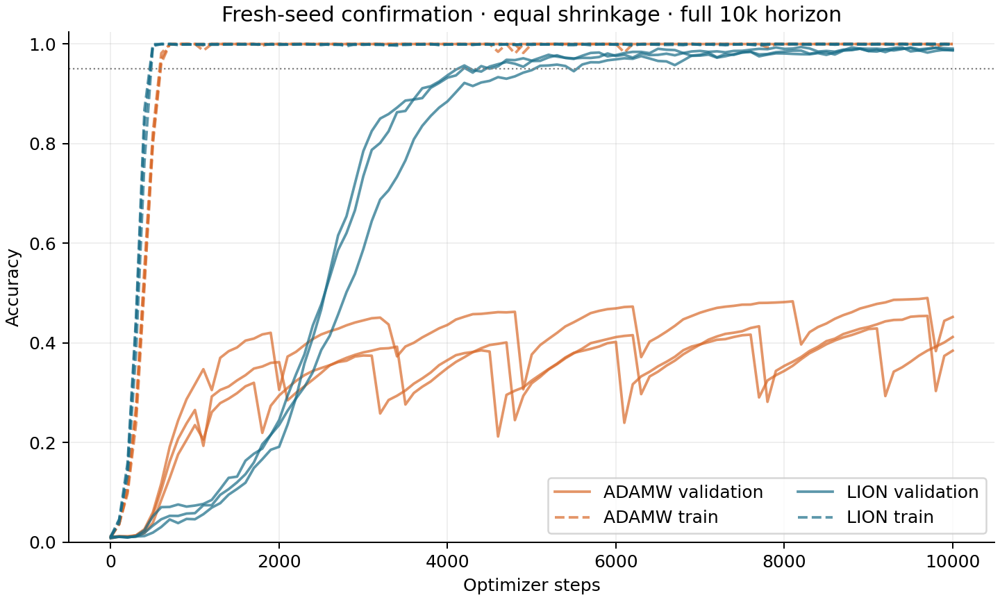
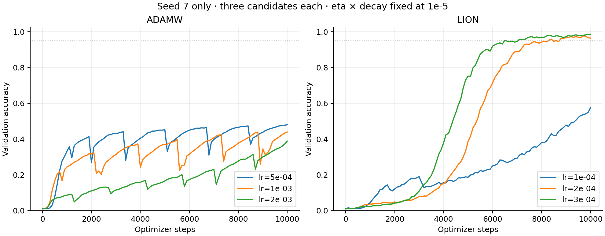

# Lion: a member contribution to COMP6704 Group 7

HUANG Yuqi · Deep Learning Optimizer Comparison · 28 October 2026

Code and full evidence: https://github.com/COMP6704-G7/grokcomp/tree/Lion

This chapter supplies one member's algorithm contribution for integration into the group report. It does not replace the group's other implementations, complete literature survey, member information or combined report/slides submission.

## 1. Introduction and related work

The question is whether Lion's sign-based momentum updates improve observed generalization and storage cost on a shared modular-arithmetic task, and how that comparison depends on regularization and the evaluation horizon. Small algorithmic datasets allow memorization and delayed generalization to be studied separately; this is the grokking setting described by Power et al. [3]. The task is a controlled optimization benchmark, not evidence of deployment performance on real data.

Chen et al. introduced Lion through symbolic optimizer discovery [1]. Unlike AdamW's first- and second-moment normalization, Lion stores one momentum tensor and applies a coordinatewise sign update. Loshchilov and Hutter distinguish decoupled weight decay from adding an L2 term to the gradient in adaptive methods [2]. This distinction motivates explicitly controlling the per-step shrinkage ηλ when comparing algorithms. The group's model/task implementation comes from its Grokfast-derived repository [4]; Grokfast gradient filtering is disabled in the new comparison.

The contribution is a local implementation and validation of published Lion, plus paired experiments that distinguish training fit, first validation crossing, sustained observed accuracy and optimizer-state memory. Lion is not proposed as a new algorithm here. The comparison changes with the parameter regime; reporting the earlier unfavorable results is necessary to interpret the current advantage.

## 2. Problem formulation

Generate all 9312 pairs x ∈ {0,…,96}, y ∈ {1,…,96}, with target z = xy mod97. Split the data into 4656 training and 4656 validation examples. A two-layer causal Transformer has width 128, four attention heads and feed-forward width 512. The input is [x, op, y, eq]; the logits at the final input position predict z. The inherited head has 99 classes including two special tokens, and all 99 classes enter the cross-entropy.

The unconstrained, nonconvex optimization problem is:

minimize over θ ∈ R^P: F(θ) = (1 / |D_train|) Σ_(x,y,z ∈ D_train) −log softmax(f_θ([x,op,y,eq]))_z.

Here θ contains all trainable network parameters; P=422,784. Batch gradients estimate the gradient of this training objective. Validation accuracy is measured on held-out pairs. There are no explicit feasibility constraints on θ. Decoupled weight shrinkage is an algorithmic operation used by both optimizers; its λ is not implemented by inserting an L2 gradient into F.

A seed first initializes the model on CPU and then generates the data permutation, preserving the original group RNG order. Within a seed both methods have the same initial weights, train/validation indices and batch permutations. Different seeds can have different splits. The tuning seed and confirmation seeds are separate; validation is used for selection, so these results are not an untouched test-set estimate.

## 3. Lion algorithm, implementation and analysis

For the current batch gradient g_t, old momentum m_(t−1), learning rate η_t and decay λ, initialize m_0=0 and apply:

u_t = sign(β1 m_(t−1) + (1−β1) g_t)

θ_t = (1−η_t λ) θ_(t−1) − η_t u_t

m_t = β2 m_(t−1) + (1−β2) g_t.

Direction uses the old momentum. Updating momentum first would implement a different algorithm. sign(0)=0. The local `Lion.step` implements these operations directly with β1=.9 and β2=.99. It supports parameter groups, closure and state serialization; parameters with absent gradients are skipped, and sparse/complex updates are rejected. The training path does not call the official Lion implementation.

Correctness is checked by a manually calculated two-step example that detects the wrong momentum order; 40-step identical-gradient comparisons with the official implementation in FP32/FP64 require exact parameter and momentum equality. Further tests cover groups, zero/absent gradients, state restore, exact original model/split behavior, streak metrics and interrupted training resume.

For P parameters, both Lion and AdamW perform O(P) optimizer work per update. Lion stores P floating-point moments; AdamW stores 2P plus small step scalars. Their FP32 persistent state costs are approximately 4P and 8P bytes. Both need parameters, gradients, activations and temporary tensors; moment storage is not total training memory. End-to-end update time also includes forward/backward computation and sampling, so it cannot establish isolated optimizer-kernel speed.

A conditional descent analysis explains an important limit. For an L-smooth objective, full gradient q=∇F(θ), sign direction s and decoupled update h=−η(s+λθ), the descent lemma gives:

F(θ+h) ≤ F(θ) − η q·(s+λθ) + (Lη²/2) ||s+λθ||².

Descent therefore needs suitable alignment and a sufficiently small step. With λ=0, zero old momentum and exact gradients, s=sign(q), so q·s=||q||_1≥0. Stochastic gradients, accumulated momentum and decay can change that alignment. This special-case observation is not a convergence proof for the experimental Transformer. Constant learning rates and nonzero sign updates need not tend to zero near a stationary point. We claim empirical convergence behavior within a finite horizon, not global convergence or a general rate guarantee.

## 4. Experimental design

Earlier exploration identified a low-shrinkage regime in which Lion generalized sooner than AdamW. Before new runs, a design file was locked; seed 7 alone then selected the configuration, which was frozen before confirming on fresh seeds 4, 5, 6. This is fresh-seed confirmation within a selected regime, not an entirely unselected experiment.

| Setting | Value |
|---|---|
| Budget | All 12 runs complete 10,000 updates; no early stopping |
| Tuning | Three candidates per optimizer, seed 7 only |
| Lion learning rates | 1e−4,2e−4,3e−4 |
| AdamW learning rates | 5e−4,1e−3,2e−3 |
| Shrinkage | ηλ=1e−5 for every candidate; λ=1e−5/η |
| Selected Lion | η=3e−4, λ=0.0333333333, β=(.9,.99) |
| Selected AdamW | η=5e−4, λ=.02, β=(.9,.98), ε=1e−8, foreach=False |
| Confirmation | Three paired seeds 4, 5, 6; serial, alternating optimizer order |
| Execution | One A100, FP32, TF32 disabled, no gradient filtering |
| Batches | Nine512-example batches and one48-example tail per epoch |
| Learning rate schedule |10-step common warmup, first update η=0, then constant |
| Evaluation | Complete train and validation sets every100 updates at identical weights |

Matching ηλ matches explicit multiplicative shrinkage, including warmup; it does not make the algorithms' implicit regularization or update norms identical. Candidate ranges and momentum settings differ by algorithm and are documented. Both selected learning rates lie at grid boundaries, limiting any interpretation as an optimized-method comparison.

Selection prioritizes val95 success, earlier three-checkpoint val95 start, higher last2000-step mean validation accuracy, higher final accuracy, then lower learning rate. The primary outcome is val95 success by10,000 and successful-crossing step. A crossing requires three consecutive evaluated checkpoints above threshold and is dated to the first of those three; step0 does not qualify. Failures remain right-censored. Successful conditional times are not divided to claim an overall speedup when success rates differ.

Secondary outcomes are val99, train99, signed val99−train99 delay, final validation accuracy, mean over 8100–10,000, post-crossing regression, time and memory. Within-horizon stable99 is explicitly retrospective: all remaining checkpoints must be≥99% with at least three observations. It does not replace the first-crossing primary outcome.

## 5. Results and analysis

| Current confirmation outcome | Lion | AdamW |
|---|---:|---:|
| val95 success |3/3 |0/3 |
| Tval95, successes only, mean±sample SD |4666.7±378.6 |All >10,000 |
| val99 success |2/3 |0/3 |
| Train99 start |500±0 |700±0 |
| Final validation accuracy |98.86% |41.64% |
| Mean validation accuracy,8100–10,000 |98.76% |41.84% |
| Persistent optimizer state |1.61MiB |3.23MiB |
| Total peak allocated GPU memory |130.61MiB |132.22MiB |

Lion's val95 starts were 4400, 4500, 5100. Its final validation accuracies were 99.08%, 98.73%, 98.78%; AdamW's were 41.22%, 45.23%, 38.47%. The mean paired difference in tail accuracy was +56.92 percentage points. Lion had only two val99 successes, and only one run satisfied retrospective stable99 through the horizon. Thus the current result supports a95% threshold advantage, not stable99 in every run.

Training-step time averaged 6.15 ms for Lion versus 6.54 ms for AdamW in these runs, including sampling, forward/backward, optimizer and synchronization, excluding full-set evaluation. This short, single-device measurement is secondary. Wall time includes evaluation and in-run logging/checkpoint overhead but excludes setup. Optimizer state is almost halved; total peak allocation changes by only about 1.2%.

Earlier high-decay experiments gave a different ranking. The initial three-seed comparison reached first val99 in 1566.7 Lion steps versus 1366.7 AdamW steps on average; a later equal-count AdamW search reduced its mean to 933.3. Continuing the initial checkpoints to 10,000 showed all three AdamW runs later below 95%, while the three Lion runs remained≥99 after confirmation. This retrospective stability result concerns the earlier high-decay configurations, not all current low-decay runs. Both findings are retained in the evidence archive.

The seed 0 decay diagnostic ran each optimizer at four decay levels, keeping its learning rate fixed and matching ηλ across methods. It showed that explicit decay changes the generalization trajectory substantially. The original group script, whose CLI actually defaults to Adam with zero decay, ended at 87.84% validation after 50,000 steps on seed 0; it did not reproduce the README's reported threshold timing. These checks motivated separating original baseline reproduction, high-decay comparisons and current low-decay confirmation.

Why might Lion help here? Equal-magnitude coordinate updates, its two momentum time scales and sign-induced update noise can change which parameters and representations are learned; the Lion paper discusses sign-related implicit regularization [1]. This is a mechanism hypothesis, not established causally by our study. Matching shrinkage excludes a difference in the explicit multiplicative factor alone; it does not isolate sign from momentum, learning rate or interactions. A causal claim would require controlled update-component ablations.

## 6. Conclusions, limitations and handoff

The implemented Lion matches the reference and reduces persistent moment storage. It shows a clear observed validation advantage on three fresh seeds within the selected low-shrinkage condition, while earlier settings give AdamW faster first crossing. The strongest supported statement is conditional: optimizer rankings depend on the decay regime, search range, observation horizon and whether first crossing or observed persistence is evaluated.

Three seeds provide limited precision; the statistical summaries are descriptive, and no significance test or universal superiority claim is made. The task is small and synthetic. There is no independent test set; hyperparameters use validation outcomes on seed 7. Both selected values are at search boundaries. AdamW could improve with a wider search, different momentum parameters or a longer budget. Results after 10,000 are unknown. Public algorithm behavior on other tasks does not prove the same causal mechanism here.

For group integration, use the current result table with the algorithm formulas and learning curves, retain the condition-specific limitations, and combine the other members' independently implemented optimizers under an agreed protocol. The final group report must contain the GitHub link, all member names/IDs and remain ≤15 pages; this chapter is a source for that report. The 6-slide current deck and Chinese speaker notes support this member's portion of the 30-minute group presentation and 10-minute Q&A.

Suggested Q&A: Why old momentum? The direction and long-term memory use different β values. Why match ηλ? To match explicit shrinkage, not all regularization. Is it always better? No; the historical first-crossing result is unfavorable. Is memory halved? Moment storage is; total peak is reduced about 1.2%. Does three-checkpoint success guarantee stability? No; subsequent regression is measured separately.

## References

[1] Chen et al., “Symbolic Discovery of Optimization Algorithms,” 2023. https://arxiv.org/html/2302.06675v4 . Official algorithm/code: https://github.com/google/automl/tree/master/lion .

[2] Loshchilov and Hutter, “Decoupled Weight Decay Regularization,” ICLR2019. https://arxiv.org/abs/1711.05101 .

[3] Power et al., “Grokking: Generalization Beyond Overfitting on Small Algorithmic Datasets,” 2022. https://arxiv.org/abs/2201.02177 .

[4] Group source `COMP6704-G7/grokcomp`, commit93b2248e351d4bb9e4dda8ac32a6999b8970404b, based on https://github.com/ironjr/grokfast . Original source and copyright notices are included; see `docs/PROVENANCE.md`.
