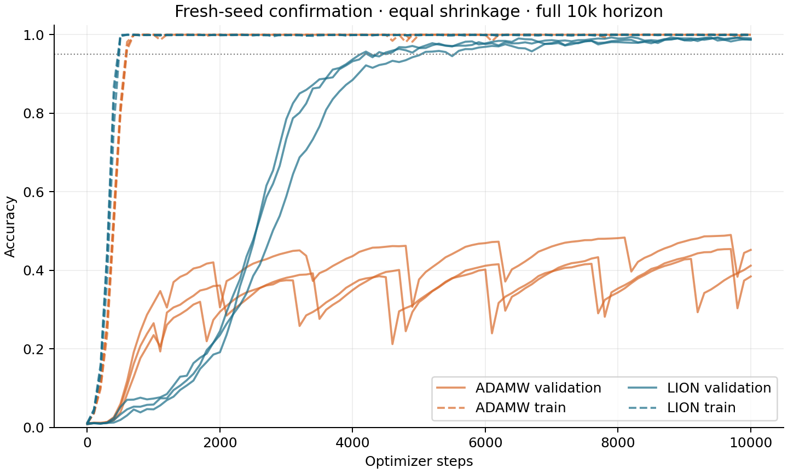
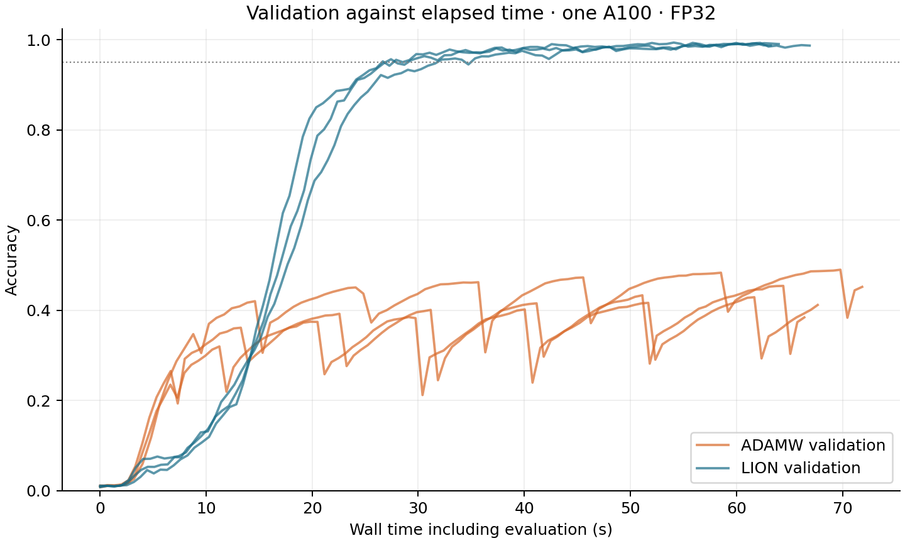
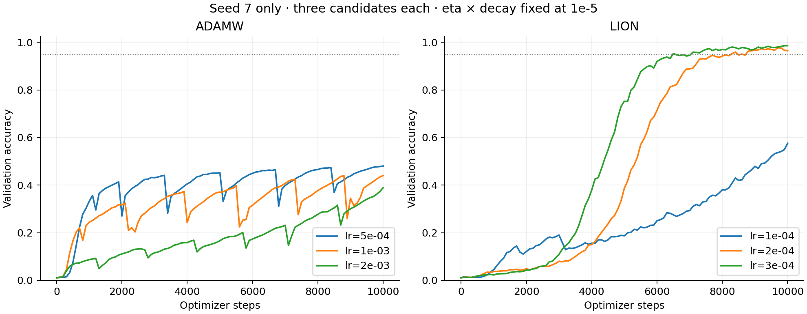
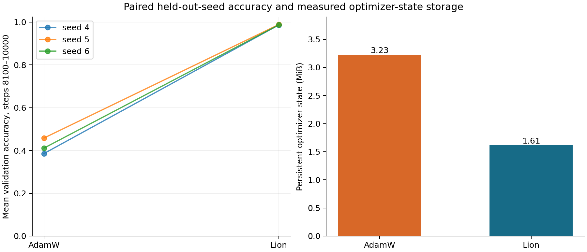

# Lion 优势验证：新 seed、等次数调参与相同收缩强度

本轮先冻结设计，再在seed7上各筛选三个候选，选定后用未参与选择的seed4/5/6完成确认。低衰减场景来自之前探索，属于对已发现条件的独立seed验证，不能推广到所有任务或参数。

## 已冻结协议

设计锁定时间：2026-10-27T01:32:25.008765+08:00；学习率冻结时间：2026-10-27T01:39:14.868387+08:00。
原组库模型、mod97模乘和50%划分保持一致；同seed相同初始化、划分和取样。所有候选和确认运行都满10000步，FP32，每100步完整评估，阈值要求连续三次。每候选及两方法间ηλ都固定1e-5，weight_decay=1e-5/lr。Lion由本项目自写，AdamW为内置对照。

选择结果：Lion lr=3e-04, λ=0.0333333；AdamW lr=5e-04, λ=0.02。
选择规则对双方相同：95%达标优先、达标起点更早、末2000步均值更高、最终准确率更高、lr更低。

## 新seed确认结果

| 指标 | Lion | AdamW |
|---|---|---|
| val95 达标数/3（主指标） | 3/3 | 0/3 |
| Tval95 步数，成功样本均值±SD | 4666.7 ± 378.6 | — |
| val99 达标数/3 | 2/3 | 0/3 |
| 末2000步平均val准确率 | 98.76% | 41.84% |
| 最终val准确率 | 98.86% | 41.64% |
| 优化器状态 / MiB | 1.61 | 3.23 |

达标均值只纳入成功样本，不能把两边不同成功数的条件均值直接当总体速度比。未达标标记>10000。标准差为样本SD；每列有效n见comparison.json。末窗口取8100至10000步共20个检查点。

| 方法 | seed | Tval95 | Tval99 | 最终val | 末窗口val均值 |
|---|---|---|---|---|---|
| adamw | 4 | >10000 | >10000 | 41.22% | 38.57% |
| adamw | 5 | >10000 | >10000 | 45.23% | 45.82% |
| adamw | 6 | >10000 | >10000 | 38.47% | 41.12% |
| lion | 4 | 4400 | 9800 | 99.08% | 98.68% |
| lion | 5 | 4500 | 7900 | 98.73% | 98.87% |
| lion | 6 | 5100 | >10000 | 98.78% | 98.72% |

## 结论范围

这三个新seed在预定主指标上观察到Lion优势。
末窗口验证准确率的平均差（Lion−AdamW）为56.92个百分点。内存优势针对持久优化器状态，不是整个训练显存减半。三个seed不能支持普适或显著性结论；没有根据确认结果重选lr、λ、seed或预算。本轮选中值位于候选边界，结果限定于已列明的候选范围，不称为全局最优比较。

