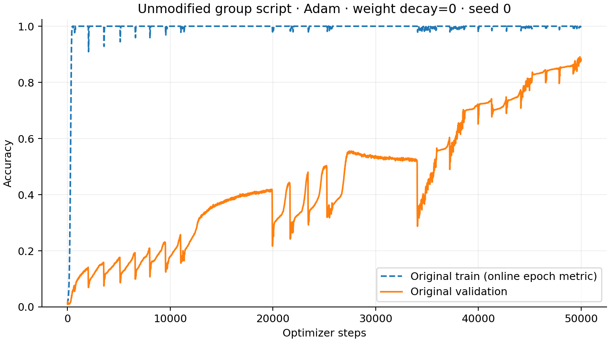
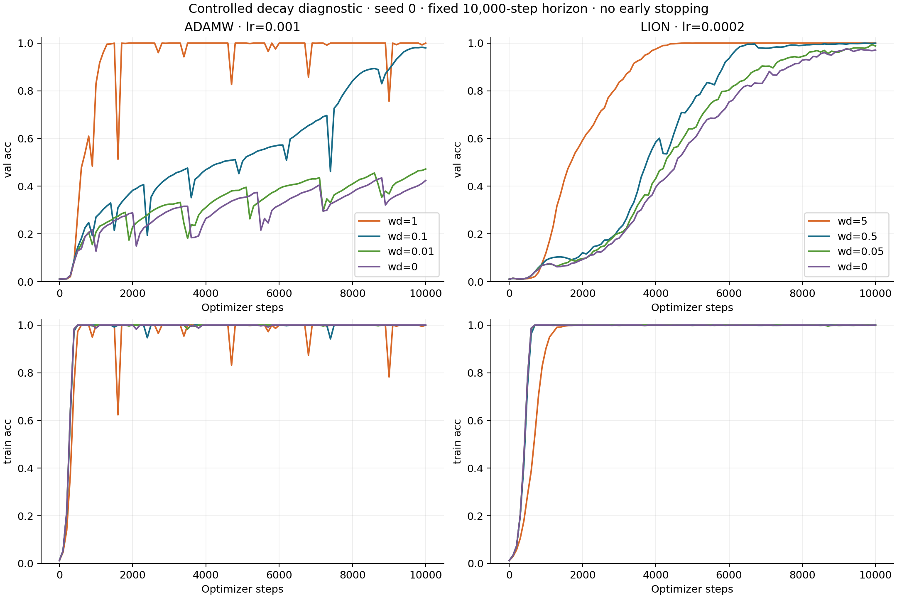

# 第二轮诊断与重跑

## 已查明的配置差异

原仓库入口实际默认 Adam、weight_decay=0；上一轮本地协议采用 AdamW、weight_decay=1，Lion=5。原文件的注释虽提到AdamW/1，但注释不是入口实际配置。此前把这一试跑值当作正式组内基线并过早宣布完成，是实验解释上的错误。

上一轮日志是真实结果，仍只对其明确配置有效；不能拿它替代原仓库基线复现，也不能由此推断Lion对长延迟grokking的普遍影响。

## 泄漏与评估核对

六个已保存的正式检查点经独立推理复算，准确率与日志一致；训练验证索引不相交且覆盖全集。打乱验证标签后的准确率约0.67%–1.31%；改变未来答案token，对前一个位置的logits影响为0。这些检查没有发现答案泄漏或把训练集冒充验证集的证据。详情见checkpoint_audit.json。

## 原始脚本复现

原始代码不改训练循环，seed0、Adam/λ=0，运行50000步。最终训练准确率99.63%，验证准确率87.84%；首次单次val95=None，val99=None。这里报告原始逐epoch验证指标，不与新协议三次连续阈值混为同一种统计。

## 控制变量重跑

保持原模型、seed0划分、batch、评估及训练取样方式不变；每个方法内部仅改变weight decay。AdamW学习率固定1e-3；Lion固定2e-4、衰减为AdamW的5倍，保证两方法的峰值ηλ匹配。所有运行固定10000步，关闭达标停止，以检查后续稳定性。此为探索性诊断，不能当成新的三seed正式比较。

| 优化器 | λ | ηλ | Ttrain99 | Tval95 | Tval99 | 最终val | 首次确认99%后最低val | 预算内持续99%起点 |
|---|---|---|---|---|---|---|---|---|
| adamw | 0 | 0 | 500 | >10000 | >10000 | 42.40% | — | — |
| adamw | 0.01 | 1e-05 | 500 | >10000 | >10000 | 47.21% | — | — |
| adamw | 0.1 | 0.0001 | 500 | 9400 | >10000 | 98.00% | — | — |
| adamw | 1 | 0.001 | 600 | 1200 | 1300 | 100.00% | 51.31% | 9100 |
| lion | 0 | 0 | 700 | 8500 | >10000 | 97.08% | — | — |
| lion | 0.05 | 1e-05 | 700 | 8200 | >10000 | 98.78% | — | — |
| lion | 0.5 | 0.0001 | 700 | 6100 | 6500 | 99.96% | 97.85% | 8000 |
| lion | 5 | 0.001 | 1300 | 3800 | 4300 | 100.00% | 99.74% | 4300 |

预算内持续99%起点是回顾性指标：从该检查点起到10000步的所有观测均≥99%，且至少有三个观测。它仅表示已观察区间内的稳定性，不保证预算结束之后也保持；不替换原计划中的三次连续阈值。

诊断seed0的高衰减AdamW在首次确认99%之后出现过明显回落；原停止规则会掩盖这种后续不稳定。不能据此断言原三个正式seed都出现同样回落；六个原检查点的续跑另列于formal_stability。这是停止规则与结论范围的限制，不能把首次达标等同于稳定泛化。

## 如何使用

不要为了让Lion赢而挑设置。先区分原仓库复现、固定配置比较、控制变量诊断三类证据；只有在基线任务和参数冻结后，才能将选定设置用于新的多seed确认。任何未达标的诊断均按10000步右删失报告，不能据此说永远不会grok。
