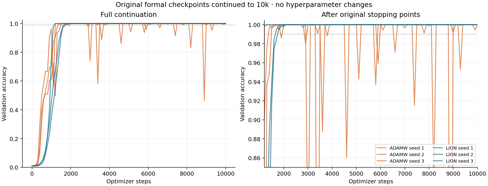

# 原六次正式运行的固定预算续跑

原有六次固定基线比较的参数、优化器状态、随机数和取样状态完整延续到10000步，不重新调参。原始日志前缀逐行相同，已自动验证。此前的首次阈值指标保留，新增稳定性观察。

| 方法 | seed | 首次val99 | 原停止步 | 达标后最低val | 最低点步数 | 预算内持续99%起点 | 最终val |
|---|---|---|---|---|---|---|---|
| adamw | 1 | 1500 | 1700 | 58.10% | 3400 | 6700 | 100.00% |
| adamw | 2 | 1400 | 1600 | 46.52% | 8900 | 9400 | 100.00% |
| adamw | 3 | 1200 | 1400 | 94.27% | 5100 | 5200 | 100.00% |
| lion | 1 | 1200 | 1400 | 100.00% | 1400 | 1200 | 100.00% |
| lion | 2 | 1800 | 2000 | 99.85% | 2000 | 1800 | 100.00% |
| lion | 3 | 1700 | 1900 | 99.96% | 1900 | 1700 | 100.00% |

预算内持续99%起点是回顾性指标：从该点到10000步所有已观察准确率都≥99%，且至少三个检查点。它不是事先注册的主指标，也不保证10000步以后稳定；不能静默替换原有首次达标排名。

续跑分为两个计算时段，离线停机不计时；这里比较步数和准确率，不据此重新宣称wall-time优势。本项只核对原固定AdamW/1与Lion/5比较，没有继续补充搜索选出的AdamW/2e-3那一组。
