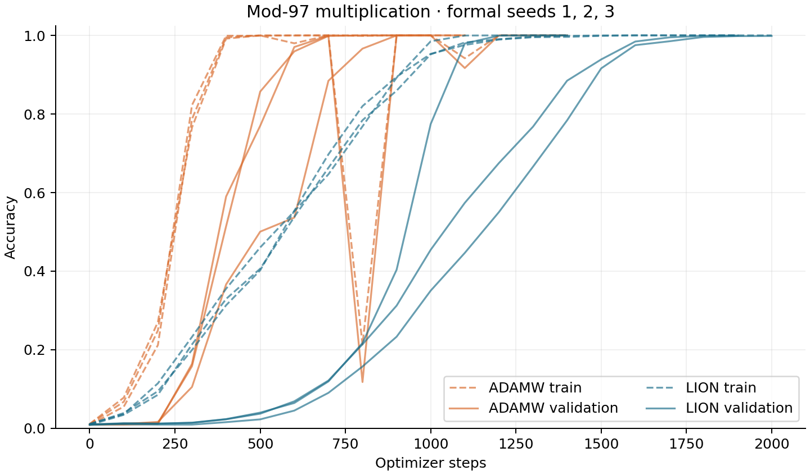
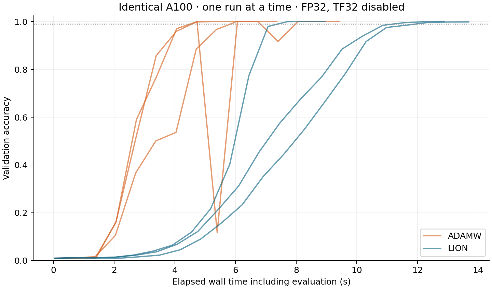
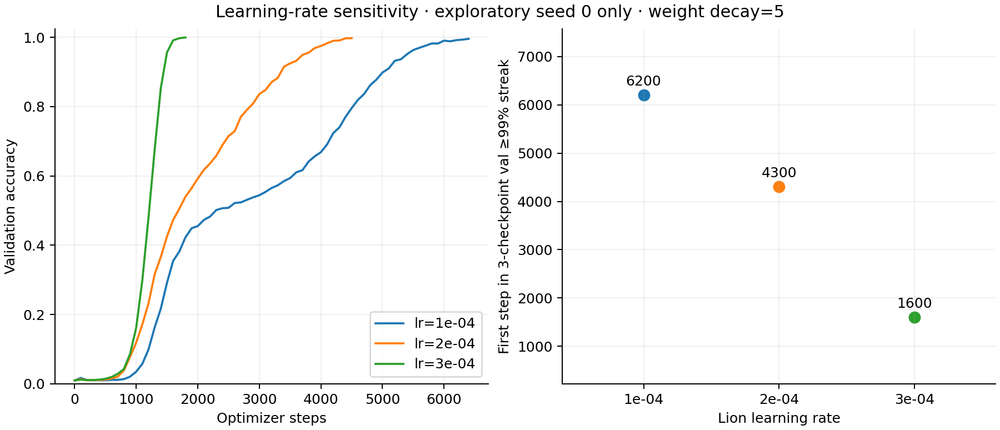

# Lion / AdamW 等次数调参补充实验

数据来自真实训练日志；仅汇总 formal 阶段，pilot 与单 seed 学习率筛选不混入正式统计。

| 方法 | val95 达标 | val99 达标 | Ttrain99 | Tval95 | Tval99 | ΔT | val99 时间/s | 每步/ms |
|---|---|---|---|---|---|---|---|---|
| LION | 3/3 | 3/3 | 1200.0 ± 100.0 | 1433.3 ± 288.7 | 1566.7 ± 321.5 | 366.7 ± 230.9 | 10.5 ± 2.5 | 6.3 ± 0.2 |
| ADAMW | 3/3 | 3/3 | 500.0 ± 173.2 | 866.7 ± 305.5 | 933.3 ± 251.7 | 433.3 ± 321.5 | 6.3 ± 1.7 | 6.4 ± 0.0 |

均值 ± 样本标准差（ddof=1）；每列 CSV 同时给出有效 n。达标时间与步数仅对成功运行统计。
连续三次评估达标后记第一检查点；停止发生在第三检查点。ΔT 保留原始符号。

## 逐次运行

| 方法 | seed | lr | ηλ | Tval99 | 最终 val acc | 训练步数 |
|---|---|---|---|---|---|---|
| adamw | 1 | 2e-03 | 0.002 | 900 | 100.0000% | 1100 |
| adamw | 2 | 2e-03 | 0.002 | 1200 | 100.0000% | 1400 |
| adamw | 3 | 2e-03 | 0.002 | 700 | 100.0000% | 900 |
| lion | 1 | 3e-04 | 0.0015 | 1200 | 100.0000% | 1400 |
| lion | 2 | 3e-04 | 0.0015 | 1800 | 99.8497% | 2000 |
| lion | 3 | 3e-04 | 0.0015 | 1700 | 99.9570% | 1900 |

## 资源

| 方法 | 峰值分配显存/MiB | 优化器持久状态/MiB |
|---|---|---|
| lion | 130.61 | 1.61 |
| adamw | 132.22 | 3.23 |

显存为 torch.cuda.max_memory_allocated，包含模型、梯度、状态和前向/反向临时分配；不等于 nvidia-smi 占用。
每步耗时包含取样、前向、反向、优化器和同步；不含完整集合评估。wall time 包含评估和运行期间日志/检查点开销，不含模型初始化。
断点续跑的离线停机时间不计入 wall time，segments>1 的运行需单独解释计时。

## 图表

## 限制

三个 seed 只反映本模型、任务和配置下的波动，不能推出普适优势。
Lion 与 AdamW 各有三次 seed0 学习率筛选，每次上限100000步，采用相同阈值、停止和选择规则。AdamW 候选为5e-4、1e-3、2e-3；选出的学习率为2e-03。
这项补充设计在首次固定基线比较后加入，不能视为事前注册的确认性实验。两种算法使用各自学习率范围和固定衰减，没有声称搜索到全局最优；实际搜索计算量因提前达标而不同。正式Lion结果来自原始运行，通过相对符号链接复用并保留来源，未重复计算或伪造。
预算和权重衰减采用计划中的试跑起点（100000 步、AdamW=1、Lion=5），已冻结于本次本地实验，尚需组内确认。
